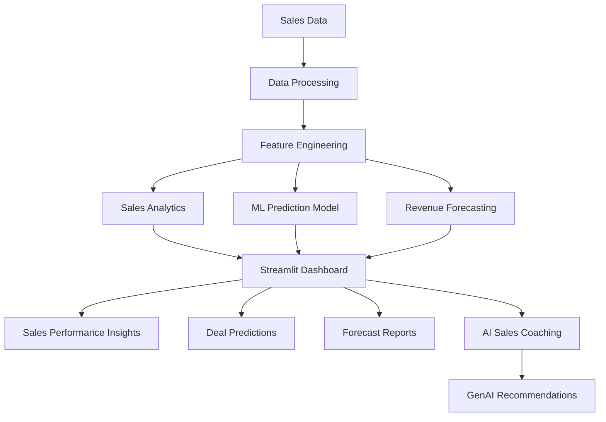

# RevPilot AI
### AI-Powered Sales Management & Revenue Intelligence Platform

RevPilot AI is a sales management and analytics application developed to help organizations monitor sales activities, evaluate team performance, and make better decisions using data.

The platform brings together sales tracking, pipeline analysis, revenue forecasting, machine learning-based deal prediction, and AI-assisted sales coaching in one place.

Instead of managing sales information across multiple spreadsheets, the application provides a centralized dashboard where sales managers can review performance, identify potential risks, and understand how their teams are progressing towards their targets.

---

## Project Overview

Managing a sales team involves more than tracking completed deals. Sales managers need to monitor individual performance, understand pipeline movement, estimate future revenue, and identify opportunities that require attention.

RevPilot AI addresses these requirements through an integrated dashboard supported by data analytics and machine learning.

The application uses historical sales information to generate insights and provides visual reports that make sales performance easier to understand.

## Key Features

### 1. Sales Performance Dashboard
- Centralized view of important sales metrics.
- Revenue and sales performance monitoring.
- Interactive charts and visual reports.
- Sales representative performance comparison.
- Overview of pipeline activities.

### 2. Sales Pipeline Management
- Monitor deals across different pipeline stages.
- Track deal values and sales opportunities.
- Identify deals that require additional attention.
- Analyze the current status of sales opportunities.

### 3. Revenue Forecasting
- Analyze historical sales trends.
- Generate future revenue estimates.
- Compare forecasted revenue with actual performance.
- Support sales planning through historical data analysis.

### 4. Machine Learning-Based Deal Prediction
- Predict the likelihood of a sales opportunity being won.
- Use an XGBoost classification model.
- Process sales-related features for prediction.
- Save trained models for application use.

### 5. AI-Powered Sales Coaching
- Generate sales improvement suggestions.
- Provide recommendations based on representative performance.
- Support deal reviews and sales decision-making.
- Use Generative AI to assist sales representatives.

### 6. Sales Analytics
- Analyze individual and team performance.
- Visualize important sales trends.
- Compare performance across representatives.
- Present business information through interactive charts.

---

## Technology Stack

| Category | Technologies |
|---|---|
| Programming Language | Python |
| Frontend / Dashboard | Streamlit |
| Data Processing | Pandas, NumPy |
| Data Visualization | Plotly |
| Machine Learning | Scikit-learn, XGBoost |
| Model Storage | Joblib |
| AI Integration | OpenAI API |
| Development Environment | VS Code |
| Version Control | Git & GitHub |

---

## System Architecture

The application follows a modular structure that separates data processing, machine learning, analytics, and dashboard presentation.



---

## Machine Learning

Machine learning is used to support sales opportunity analysis.

### XGBoost Classification Model

The project includes an XGBoost classification model trained on historical sales data to estimate whether a sales opportunity is likely to be won.

The training workflow includes:

1. Loading and preparing the sales dataset.
2. Cleaning and processing input features.
3. Preparing training and testing data.
4. Training the XGBoost classifier.
5. Evaluating model performance.
6. Saving the trained model for future predictions.

**Model artifacts:**

- `models/xgb_win_model.joblib` – Trained classification model.
- `models/model_features.json` – Saved model feature information.

The saved model can be loaded by the application to generate predictions without retraining every time.

---

## Project Structure

The project is organized into separate directories to keep the application code, machine learning components, and generated files manageable.

```text
SalesManagementSystem/
│
├── app.py
│
├── data/
│   ├── raw/
│   └── processed/
│
├── models/
│   ├── xgb_win_model.joblib
│   └── model_features.json
│
├── src/
│   ├── ml_models/
│   │   └── train_xgboost.py
│   │
│   └── other_modules/
│
├── reports/
│
├── requirements.txt
├── README.md
└── .gitignore
```

*Note: This is the documented project structure. Adjust the folder names to match the actual files in your repository.*

---

## Installation and Setup

Follow these steps to run the application locally.

### 1. Clone the Repository

```bash
git clone https://github.com/YOUR_USERNAME/YOUR_REPOSITORY.git
```

### 2. Navigate to the Project Directory

```bash
cd SalesManagementSystem
```

### 3. Create a Virtual Environment

```bash
python -m venv venv
```

### 4. Activate the Environment

**Windows:**

```bash
venv\Scripts\activate
```

### 5. Install Dependencies

```bash
pip install -r requirements.txt
```

### 6. Configure API Credentials

If using the AI coaching functionality, configure a valid OpenAI API key through an environment variable or the project's existing configuration.

Do not upload API keys or other credentials to GitHub.

### 7. Run the Application

```bash
streamlit run app.py
```

The application will open in your browser.

---

## Model Training

To train the XGBoost classification model, run:

```bash
python src/ml_models/train_xgboost.py
```

After successful training, the model is saved in the `models/` directory for use by the application.

Make sure the required training dataset is available at the location expected by the training script.

---

## Project Objectives

The main objectives of SalesVision AI are:

- Reduce manual effort in sales performance monitoring.
- Provide a centralized view of sales activities.
- Improve visibility into the sales pipeline.
- Use machine learning to support deal evaluation.
- Generate revenue forecasts using historical data.
- Assist sales representatives through AI-powered coaching.
- Help managers make informed, data-driven decisions.

---

## Future Enhancements

Some improvements that can be considered for future development include:

- Role-based access for administrators, managers, and representatives.
- Integration with external CRM platforms.
- Automated email notifications for important sales activities.
- Advanced forecasting models.
- More detailed commission management.
- Exportable sales performance reports.
- Enhanced AI-based deal recommendations.

---

## Project Information

**Project Name:** RevPilot AI

**Project Category:** Artificial Intelligence / Machine Learning / Sales Analytics

**Application Type:** Web-Based Sales Management System

**Primary Language:** Python

**Development Tools:** VS Code, Git, GitHub

**Project Purpose:** Internship Project

---

## Author

Developed as part of an internship project, focusing on Python development, machine learning, data analytics, and Generative AI integration.

---

